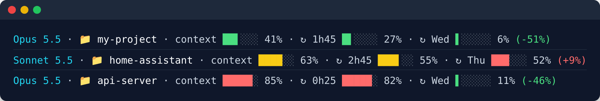

# cc-usage-bars

Claude Code plan usage as compact colored bars — in the **Claude Code status line** and,
optionally, on a **Home Assistant** dashboard.



- **Context** — how full the context window is: 🟢 < 60% · 🟡 60–80% · 🔴 ≥ 80%.
- **Session (5 h window)** — label is the time left until it resets.
  Color by usage: 🟢 < 40% · 🟡 40–75% · 🔴 > 75%.
- **Week (7 d window)** — label is the reset weekday (or `HH:MM` on reset day).
  Color by **pace**: projects where you'll end the week if you keep the current rate
  (`used% ÷ fraction of the week elapsed`): 🟢 < 90% · 🟡 90–100% · 🔴 > 100% (you'll run out).
  The first ~3 h of each week use the session bands, since the projection is noise.
  The weekly % is followed by `(+N%)` / `(-N%)`: how many points above/below the pro-rata
  usage for the elapsed part of the week you are (e.g. `14% (-43%)` = well under budget).

## 1. Claude Code status line (no API calls)

Claude Code already pipes `rate_limits.five_hour` / `seven_day` (`used_percentage`,
`resets_at`) into the status line command, so this is just formatting.

```bash
cp statusline/statusline.sh ~/.claude/statusline.sh && chmod +x ~/.claude/statusline.sh
```

`~/.claude/settings.json`:

```json
{ "statusLine": { "type": "command", "command": "~/.claude/statusline.sh" } }
```

Needs `jq`, `awk` and GNU `date`. Weekday names follow your locale (`LC_TIME`/`LANG`).
Tunables (env): `CC_BARS_WIDTH` (6), `CC_BARS_CONTEXT_YELLOW` (60), `CC_BARS_CONTEXT_RED` (80), `CC_BARS_SESSION_YELLOW` (40), `CC_BARS_SESSION_RED` (75),
`CC_BARS_PACE_YELLOW` (90), `CC_BARS_PACE_RED` (100).

## 2. Home Assistant (optional)

```
↻ 1h31 ██░░░░ 32% · ↻ qui ▌░░░░░ 11% · DS $5.87
```

| File | Goes to | What |
|---|---|---|
| `homeassistant/claude_usage.yaml` | `/config/packages/` | Webhook-fed sensors `sensor.claude_code_sessao`, `sensor.claude_code_sessao_renova`, `sensor.deepseek_saldo` + low-balance notification |
| `homeassistant/card_usage.md.j2` / `card.yaml` | dashboard | Markdown card with the same one-line bars (set `grande = true` for a larger version on wall displays) |

This repo does **not** ship a collector: the status line gets its numbers from Claude Code
itself, but Home Assistant has no official source for plan usage. Feed the sensors from
whatever you are comfortable with by POSTing JSON to the `claude_usage` webhook
(local network only):

```bash
curl -X POST http://homeassistant.local:8123/api/webhook/claude_usage \
  -H 'Content-Type: application/json' \
  -d '{"session_pct": 32, "session_resets": "2026-10-30T13:30:00+00:00",
       "weekly_pct": 11, "weekly_resets": "2026-11-05T21:00:00+00:00", "plan": "pro"}'
```

| Field | Required | Meaning |
|---|---|---|
| `session_pct`, `session_resets` | yes | 5 h window: % used, ISO reset time |
| `weekly_pct`, `weekly_resets` | yes | 7 d window: % used, ISO reset time |
| `session_severity`, `plan` | yes (may be `""`) | informational attributes |
| `weekly_opus`, `weekly_sonnet` | no | `{"pct": n, "renova_em": iso}` — per-model weekly bars, when your plan has them |
| `extra_enabled`, `extra_pct`, `extra_used`, `extra_limit`, `extra_currency` | no | extra usage credits |
| `deepseek_balance`, `deepseek_currency`, `deepseek_available` | no | DeepSeek prepaid balance (from `GET https://api.deepseek.com/user/balance`) |

Optional fields that are missing keep their previous value (DeepSeek) or hide their bar.

Setup: enable packages in `configuration.yaml` (`homeassistant: packages: !include_dir_named packages`),
copy the package, reload *Template entities* and *Automations*, then add the card from
`homeassistant/card.yaml` (day names are a list at the top of the template). The DeepSeek
balance is colored 🔴 < $1 · 🟡 < $2, and the package notifies once when it drops below $1
(edit the `notify.notify` action to your service). If no update arrives for 30 min the card
shows ⚠.

Code comments and entity names are in Portuguese (pt-BR); PRs welcome.

## License

MIT
